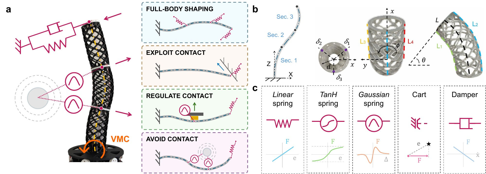
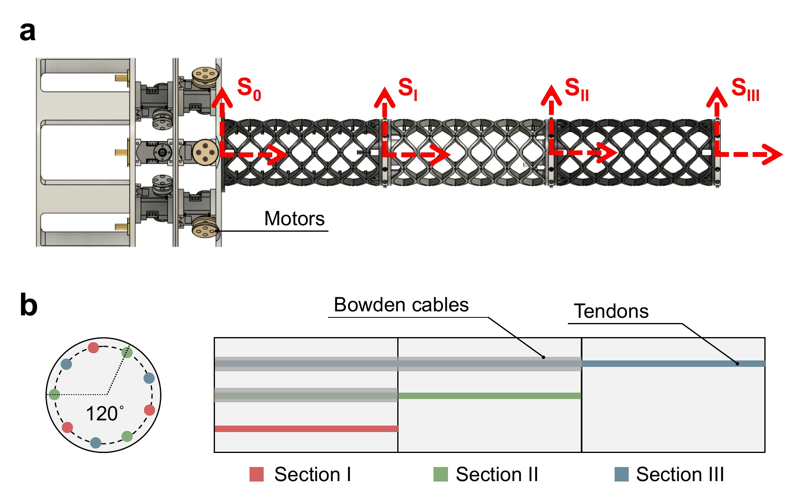

# SoftVMC

*Virtual Model Control (VMC) for full-body regulation and compliance shaping
of a tendon-driven soft continuum arm.*

<p align="center">
  
</p>

<sub>**Figure 1.** Virtual springs, dampers and Gaussian fields are attached at points along the soft arm's body and mapped to motor torques through a Piecewise Constant Curvature model. One mechanism shapes the whole body and can exploit, regulate or avoid contact.</sub>

## What it does

VMC attaches virtual mechanical elements, such as springs, dampers and potential
fields, to points along the arm and maps their forces to motor torques through
the kinematic Jacobians, `τ = Σᵢ Jᵢ(q)ᵀ fᵢ`. The arm behaves as if those
elements were physically present. It needs no inverse kinematics and no
replanning: reaching a goal and responding to the environment both come from
one virtual model, and passive elements keep the interaction stable. This gives:

- **Full-body shaping**: elements attached anywhere along the body set the configuration of the whole arm, not just the tip. A moving element extends this to trajectory regulation.
- **Stiffness and force rendering**: the virtual stiffness sets the compliance the environment feels at the tip, and a saturating (tanh) spring bounds the force the arm applies.
- **Exploiting contact**: a compliant tip spring lets the arm slide along a surface on its way to a goal instead of fighting it.
- **Regulating contact**: Gaussian elements on intermediate body points set how hard the body presses on an object while the tip keeps reaching.
- **Avoiding contact**: the same Gaussian elements keep the body clear of obstacles, for a card castle and for a teleoperated handover that is replayed around an obstacle.

<p align="center">
  
</p>

<sub>**Figure 2.** The three-section tendon-driven arm. Nine motors at the base drive three tendons per section, 120° apart, routed through Bowden cables to Sections II and III. S₀ to S_III are the section frames of the PCC model.</sub>

## Platform

| | |
|---|---|
| **Soft continuum arm** | Three-section trimmed-helicoid arm, 43.5 cm long when straight, driven by nine Dynamixel motors (IDs 11–19, three per section) and modelled with Piecewise Constant Curvature (PCC) |
| **Load cell** | Arduino with HX711 load cells, measuring the shear force on a tendon tied to the tip or on a button pressed by the arm |

## Virtual elements

The five elements used in the experiments (Fig. 1c), from `VMC_utils/VirtualModels.py`:

| Element | Class | Force law |
|---|---|---|
| Linear spring | `LinearSpring` | `f = K e` |
| TanH spring | `TanhSpring` | `f = F_max tanh(K e / F_max)` |
| Gaussian spring | `GaussianSpring` | `f = A exp(−‖Δ‖² / 2σ²) Δ` |
| Cart | `ConstrainedLinearSpring` | `f = K n nᵀ e`, acting only along `n` |
| Damper | `LinearDamper` | `f = −c ẋ` |

In these laws, `e` is the goal minus the attachment point, and `Δ` is the
attachment point minus the Gaussian's centre. `Δ` is not normalised, so the
Gaussian strength `A` is in N/m, like `K`. Its force is zero at the centre,
peaks at `‖Δ‖ = σ` with magnitude `A σ e^(−1/2)`, and vanishes beyond about 3σ.
The same file also has sigmoid, polynomial and deadzone springs, tanh dampers
and the constrained variants of each element.

---

## Repository contents

**Experiments**: one self-contained folder per study. Each holds a VMC config
per variant (`GUI_MultiVMC_Config*.py`), the recorded runs and generated figures
(`outputs/<study>/`), and the `plot_*.ipynb` notebooks that turn the runs into
the figures.

| Folder | Study |
|---|---|
| `ContactAndShaping/` | Full-body shaping with a tip spring and a body Gaussian; surface following with a soft vs. a stiff tip spring; one tip spring vs. three distributed springs |
| `GaussianElement/` | Trajectory regulation: a Gaussian circling the tip's goal moves the tip by an amount set by the tip stiffness. Also a fixed Gaussian pushing the body off an obstacle |
| `ConstrainedSpring/` | Cart vs. linear spring: with the goal stepped along a diagonal, the cart moves the tip only along its constrained direction |
| `LinearSpring/` | Stiffness rendering: shear force and apparent stiffness at the tip across a stiffness sweep, and disturbance rejection across stiffness |
| `TanhSpring/` | Force bounding: measured shear force under a tanh spring vs. a linear spring of the same stiffness |
| `ButtonPressing/` | Contact regulation and avoidance with body Gaussians: button pressing across Gaussian strengths, a card castle, and a teleoperated handover with a person |

**Core framework**

| Folder | Contents |
|---|---|
| `Kinematics/` | PCC forward kinematics and analytical Jacobians (3 sections, 9 motors) |
| `VMC/` | VMC controller and ROS 2 nodes: torque computation, GUI, homing, scripted goal publishers |
| `VMC_utils/` | Virtual spring, damper and Gaussian primitives, gravity compensation, config loader |
| `LoadCell/` | Arduino load-cell sketch and its ROS 2 force publisher |
| `ConnectivityTest/` | Hardware sanity check that connects to the arm and moves it, saving nothing |
| `SingleVMC/` | Single-section VMC, kept for reference and offline simulation |

---

## Getting started

Home the arm and start the motor driver:

```bash
bash start_arm.sh   # home the 9 motors + USB latency timer + dynamixel node (torque mode)
```

On first use, or after any hardware change, run `ConnectivityTest/` to check
the whole chain before an experiment. Then launch from an experiment folder,
whose config is picked up from the working directory:

```bash
cd LinearSpring
python3 ../VMC/GUI_MultiVMC_Torque.py &   # VMC torque node
python3 ../VMC/GUI_MultiVMC.py            # GUI: drag goals, set stiffness
```

For a folder with several config variants, name the variant with `--config`,
and use the same variant in every command of a run:

```bash
cd GaussianElement
python3 ../VMC/GUI_MultiVMC_Torque.py --config _moving &
python3 ../VMC/GUI_MultiVMC.py --config _moving
```

`--run NAME` writes the run straight to `outputs/<study>/NAME.npz`. See
[VMC/README.md](VMC/README.md) for every flag, and each experiment folder's
README for its protocol.

**Requirements**: ROS 2 Humble with the `dynamixel_interface` package. Download it
with `git clone git@github.com:CREATE-Lab-EPFL/ros2_dynamixel.git` and build it
next to this repository: `start_arm.sh` looks for it in
`$HOME/github/ros2_dynamixel`, or in `$ROS2_DYNAMIXEL_WS` if that is set. You also need:

```bash
pip install numpy scipy sympy matplotlib pyserial dynamixel-sdk jupyter
```

The GUI also needs Tk (`python3-tk`).

## Reproducing the figures

Every `plot_*.ipynb` reads the recorded runs in its folder's `outputs/` and
writes its figures there. It needs no hardware and no ROS. The notebooks share
`plot_config.py` and `plot_config.mplstyle` (LaTeX text in Computer Modern,
pastel palette), and saving a figure as PDF also writes an SVG next to it.

The notebooks need a LaTeX install, except `TanhSpring/`, which uses mathtext.
The committed figures were made with matplotlib 3.11.2. Avoid 3.11.0: it drops
minus signs from LaTeX PDFs.

## Documentation

- [VMC/README.md](VMC/README.md): nodes, run flags (`--config`, `--run`, `--gravity-dir`) and hardware notes
- [VMC/VMC_DOCUMENTATION.md](VMC/VMC_DOCUMENTATION.md): the VMC formulation, node and topic architecture, virtual element API, and the recorded `.npz` format
- [VMC_utils/README.md](VMC_utils/README.md): virtual element classes and gravity compensation
- [Kinematics/KINEMATICS_DOCUMENTATION.md](Kinematics/KINEMATICS_DOCUMENTATION.md): PCC derivation and Jacobians
- Each experiment folder's `README.md`: protocol, recorded runs, and which notebook makes which figure

## License

MIT. See [LICENSE](LICENSE).
